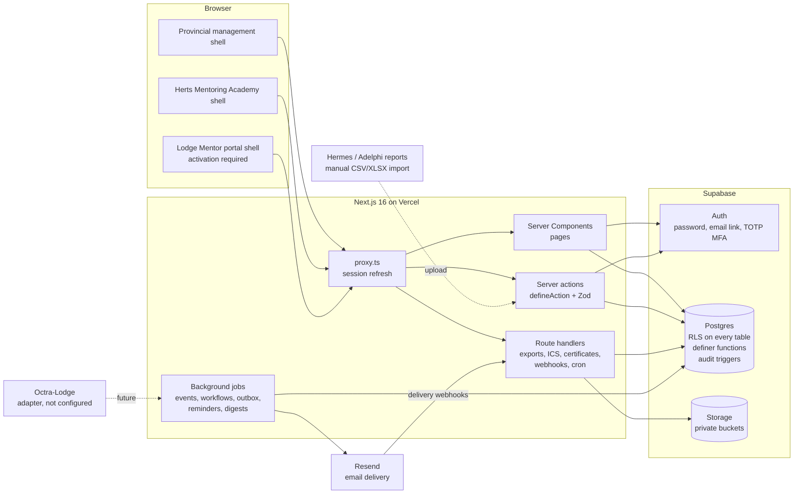
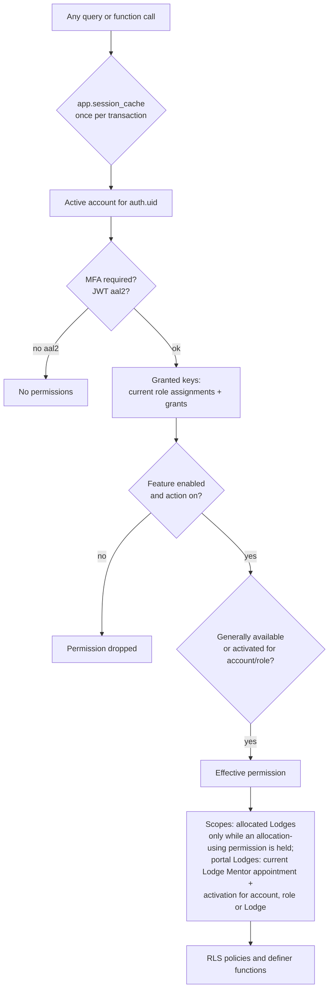

# Architecture

The Hertfordshire Provincial Mentoring Hub is one integrated application with two first-release experiences (Provincial management and the Herts Mentoring Academy) and a third (the Lodge Mentor portal) that is fully built but closed until activated.

## System overview

## Principles

1. **The database enforces access.** Row-level security on all 99 tables. The UI hides what a user cannot use, but a manipulated URL, API call, storage path or query still meets the same rules. Tested by `tests/db/learner-isolation.test.ts` and `tests/db/permissions.test.ts`.
2. **One domain model.** A person exists once. Accounts, Masonic appointments (Lodge and Provincial) and application permissions are separate records linked to the person (brief 2.D). Lodge memberships, journeys, learning history and event participation all hang off the same person.
3. **Effective dating.** Appointments, allocations, role assignments and grants carry start and end dates. History is never overwritten, and reports for past periods use the arrangements as they were.
4. **Controlled release through configuration, not code.** Feature settings and targeted activations gate modules. They can only narrow access, never widen it.
5. **Business rules live in one place.** Multi-step state changes (approvals, publication, allocation, registration capacity, scoring, certificates, import commit, campaign approval) are Postgres definer functions with explicit permission checks, called from thin server actions.
6. **Synthetic data until authorised.** No live membership data is loaded until the Province confirms the data protection position (see `docs/production-readiness.md`).

## Domains

| # | Domain | Main tables | Code |
|---|---|---|---|
| 1 | Identity and permissions | persons, user_accounts, roles, permissions, role_assignments, permission_grants, invitations, feature_settings, feature_activations | `src/server/session.ts`, `(auth)`, `admin/users` |
| 2 | Provincial administration | organisations, areas, provincial_appointments, mentoring_statuses, support_categories, document_categories | `admin/config` |
| 3 | Lodge management | lodges, meeting_centres, lodge_appointments, lodge_mentoring_profiles, lodge_reviews, lodge_status_history, lodge_change_proposals | `lodges` |
| 4 | Members and journeys | lodge_memberships, degree_events, member_journeys | `members` |
| 5 | Allocations | lodge_allocations | `allocations` |
| 6 | Contacts, notes, tasks, visits | contacts, notes, note_mentions, tasks, task_comments, visits, visit_participants, access_grants | `lodges`, `tasks` |
| 7 | Support and cases | cases, case_events | `support` |
| 8 | Team and meetings | announcements, meetings, meeting_agenda_items, meeting_attendees, meeting_decisions | `team` |
| 9 | Academy | courses, course_versions, course_modules, lessons, questions, question_keys, pathways, enrolments, lesson_progress, reflections, assessment_attempts, certificates, badges, development_plans, external_learning, solomon_resources | `(academy)/academy`, `learning` |
| 10 | Training and events | events, event_trainers, event_invites, event_resources, event_joining_details, registrations, external_booking_refs | `events`, `academy/events` |
| 11 | Calendar | calendar_feed_tokens (+ events, visits, meetings, tasks) | `calendar`, `/api/calendar` |
| 12 | Communications | comm_preferences, email_templates, segments, campaigns, campaign_recipients, email_outbox, email_delivery_events | `communications`, `src/server/email` |
| 13 | Documents and knowledge | documents, document_versions, document_acknowledgements, knowledge_articles | `library` |
| 14 | Imports | import_templates, import_batches, import_rows | `imports`, `src/server/imports` |
| 15 | Reporting | saved_reports, report_snapshots, quarterly_reports, saved_views (+ reporting views) | `reports`, `dashboard`, `src/server/reports` |
| 16 | Workflow automation | domain_events, workflows, workflow_runs | `src/server/workflows`, `admin/workflows` |
| 17 | Notifications | notifications, notification_preferences | `notifications`, `src/server/jobs` |
| 18 | System health and audit | audit_events, integrations, integration_failures, retention_policies, retention_runs | `admin/health`, `admin/audit` |

The full generated schema and ERD: `docs/database-schema.md`.

## Permission evaluation

The session cache is a transaction-local setting keyed by user and assurance level, cleared by any write to role assignments, grants, feature settings, activations, allocations, appointments or accounts. It made policy evaluation per transaction rather than per row (the Lodge overview fell from about 8 seconds to milliseconds).

Sensitive rules worth knowing:

- **Assistants** see ordinary Lodge information and basic membership across the Province; detailed journeys, contacts, visits, reviews and requests only for allocated Lodges. An allocation confers nothing once the Assistant role ends.
- **Confidential concerns** are visible only to designated triage (Provincial Grand Mentor and Deputy), the assignee they choose (explicit, audited access grant), and the person who raised it. They never feed Lodge views, counts, search, workflows or notification content. A case's confidentiality cannot be changed after creation.
- **Notes** are ordinary, team, leadership or restricted. Mentions notify but never grant access. Authors lose access to their own notes when they leave management roles.
- **Learners** see only their own person record, memberships, learning and registrations. Question answer keys and other learners' reflections are unreadable to them.
- **Technical administrators** manage accounts and configuration but cannot read cases, notes, contacts, journeys, visits or tasks.

## Background processing

Domain events are written transactionally by definer functions (`app.emit`). `src/server/jobs/index.ts` processes them: built-in reactions (confirmation and waiting-list emails, certificates, approval notices), then configured workflows. It also sends approved campaigns, reminders (events, tasks, courses, document reviews), notification emails and digests, and the email outbox with exponential backoff. Jobs run after user actions (`kickJobs()` via `next/server` `after`) and on a schedule (`/api/cron/run`, protected by `CRON_SECRET`). Rows are claimed atomically, and outbox and workflow runs are idempotent, so concurrent runs are safe.

## Integrations

| Integration | State | Notes |
|---|---|---|
| Supabase | Local stack in development | Production project, keys and backups to be configured (see deployment guide) |
| Resend | Built; local SMTP capture in development | Needs a verified sending domain and API key. Webhooks verified with the Svix signature scheme |
| Octra-Lodge | Adapter interface only | Real API not inspected. Paid/external bookings link out; Octra-Lodge stays authoritative |
| Hermes / Adelphi / UGLE Portal | Manual CSV/XLSX import | No API assumed. The import pipeline is source-neutral so an approved automated feed can be connected later |
| Solomon | Links only | No UGLE content is copied |

## Architecture decisions

See `docs/adr/`.
