# Database schema

Generated 2026-10-25 from the local database by `scripts/gen-schema-docs.sh`. Do not edit by hand.

Every table has row-level security enabled. Policies call helpers in the `app` schema; see `docs/architecture.md`.

## Entity relationships

```mermaid
erDiagram
  areas ||--o{ lodge_allocations : "area_id"
  areas ||--o{ provincial_appointments : "area_id"
  badges ||--o{ badge_awards : "badge_id"
  campaign_recipients ||--o{ email_outbox : "campaign_recipient_id"
  campaigns ||--o{ campaign_recipients : "campaign_id"
  cases ||--o{ case_events : "case_id"
  course_modules ||--o{ lessons : "module_id"
  course_versions ||--o{ certificates : "course_version_id"
  course_versions ||--o{ course_modules : "version_id"
  course_versions ||--o{ courses : "published_version_id"
  course_versions ||--o{ enrolments : "course_version_id"
  courses ||--o{ certificates : "course_id"
  courses ||--o{ course_versions : "course_id"
  courses ||--o{ development_plan_items : "course_id"
  courses ||--o{ enrolments : "course_id"
  courses ||--o{ events : "course_id"
  courses ||--o{ pathway_courses : "course_id"
  courses ||--o{ solomon_resources : "course_id"
  development_plans ||--o{ development_plan_items : "plan_id"
  document_categories ||--o{ documents : "category_id"
  document_versions ||--o{ document_acknowledgements : "document_version_id"
  document_versions ||--o{ documents : "current_version_id"
  documents ||--o{ document_versions : "document_id"
  domain_events ||--o{ workflow_runs : "domain_event_id"
  email_templates ||--o{ campaigns : "template_id"
  enrolments ||--o{ assessment_attempts : "enrolment_id"
  enrolments ||--o{ certificates : "enrolment_id"
  enrolments ||--o{ lesson_progress : "enrolment_id"
  enrolments ||--o{ reflections : "enrolment_id"
  events ||--o{ event_invites : "event_id"
  events ||--o{ event_joining_details : "event_id"
  events ||--o{ event_resources : "event_id"
  events ||--o{ event_trainers : "event_id"
  events ||--o{ external_booking_refs : "event_id"
  events ||--o{ registrations : "event_id"
  features ||--o{ feature_activations : "feature_key"
  features ||--o{ feature_settings : "feature_key"
  features ||--o{ permissions : "feature_key"
  import_batches ||--o{ import_rows : "batch_id"
  import_templates ||--o{ import_batches : "template_id"
  lessons ||--o{ assessment_attempts : "lesson_id"
  lessons ||--o{ lesson_progress : "lesson_id"
  lessons ||--o{ questions : "lesson_id"
  lessons ||--o{ reflections : "lesson_id"
  lodges ||--o{ cases : "lodge_id"
  lodges ||--o{ contacts : "lodge_id"
  lodges ||--o{ degree_events : "lodge_id"
  lodges ||--o{ events : "lodge_id"
  lodges ||--o{ feature_activations : "lodge_id"
  lodges ||--o{ lodge_allocations : "lodge_id"
  lodges ||--o{ lodge_appointments : "lodge_id"
  lodges ||--o{ lodge_change_proposals : "lodge_id"
  lodges ||--o{ lodge_memberships : "lodge_id"
  lodges ||--o{ lodge_mentoring_profiles : "lodge_id"
  lodges ||--o{ lodge_reviews : "lodge_id"
  lodges ||--o{ lodge_status_history : "lodge_id"
  lodges ||--o{ notes : "lodge_id"
  lodges ||--o{ tasks : "lodge_id"
  lodges ||--o{ visits : "lodge_id"
  meeting_agenda_items ||--o{ meeting_decisions : "agenda_item_id"
  meeting_centres ||--o{ events : "meeting_centre_id"
  meeting_centres ||--o{ lodges : "meeting_centre_id"
  meetings ||--o{ meeting_agenda_items : "meeting_id"
  meetings ||--o{ meeting_attendees : "meeting_id"
  meetings ||--o{ meeting_decisions : "meeting_id"
  mentoring_statuses ||--o{ lodge_status_history : "previous_status_id"
  mentoring_statuses ||--o{ lodge_status_history : "status_id"
  mentoring_statuses ||--o{ lodges : "mentoring_status_id"
  notes ||--o{ note_mentions : "note_id"
  pathways ||--o{ certificates : "pathway_id"
  pathways ||--o{ pathway_courses : "pathway_id"
  pathways ||--o{ solomon_resources : "pathway_id"
  permissions ||--o{ permission_grants : "permission_key"
  permissions ||--o{ role_permissions : "permission_key"
  persons ||--o{ badge_awards : "person_id"
  persons ||--o{ campaign_recipients : "person_id"
  persons ||--o{ cases : "member_person_id"
  persons ||--o{ cases : "requester_person_id"
  persons ||--o{ certificates : "person_id"
  persons ||--o{ comm_preferences : "person_id"
  persons ||--o{ contacts : "person_id"
  persons ||--o{ degree_events : "person_id"
  persons ||--o{ development_plans : "person_id"
  persons ||--o{ document_acknowledgements : "person_id"
  persons ||--o{ documents : "owner_person_id"
  persons ||--o{ email_outbox : "to_person_id"
  persons ||--o{ enrolments : "person_id"
  persons ||--o{ event_invites : "person_id"
  persons ||--o{ event_trainers : "person_id"
  persons ||--o{ external_booking_refs : "person_id"
  persons ||--o{ external_learning : "person_id"
  persons ||--o{ import_rows : "decision_person_id"
  persons ||--o{ import_rows : "matched_person_id"
  persons ||--o{ invitations : "person_id"
  persons ||--o{ learner_profiles : "person_id"
  persons ||--o{ lodge_allocations : "person_id"
  persons ||--o{ lodge_appointments : "person_id"
  persons ||--o{ lodge_memberships : "person_id"
  persons ||--o{ meeting_agenda_items : "presenter_person_id"
  persons ||--o{ meeting_attendees : "person_id"
  persons ||--o{ member_journeys : "person_id"
  persons ||--o{ member_journeys : "personal_mentor_confirmed_by"
  persons ||--o{ member_journeys : "personal_mentor_person_id"
  persons ||--o{ provincial_appointments : "person_id"
  persons ||--o{ reflections : "person_id"
  persons ||--o{ registrations : "person_id"
  persons ||--o{ user_accounts : "person_id"
  persons ||--o{ visit_participants : "person_id"
  questions ||--o{ question_keys : "question_id"
  report_snapshots ||--o{ quarterly_reports : "snapshot_id"
  retention_policies ||--o{ retention_runs : "policy_id"
  roles ||--o{ feature_activations : "role_id"
  roles ||--o{ role_assignments : "role_id"
  roles ||--o{ role_permissions : "role_id"
  tasks ||--o{ task_comments : "task_id"
  visits ||--o{ visit_participants : "visit_id"
  workflows ||--o{ workflow_runs : "workflow_id"
```

Organisation scoping (`org_id`) and account attribution columns (`created_by`, `approved_by`, ...) are omitted from the diagram for readability.

## Tables

### `access_grants`

RLS: enabled · policies: 2

| Column | Type | Null | Default |
|---|---|---|---|
| id | uuid | NO | gen_random_uuid() |
| org_id | uuid | NO |  |
| entity_type | text | NO |  |
| entity_id | uuid | NO |  |
| account_id | uuid | NO |  |
| granted_by | uuid | YES |  |
| reason | text | NO |  |
| expires_at | timestamp with time zone | YES |  |
| revoked_at | timestamp with time zone | YES |  |
| created_at | timestamp with time zone | NO | now() |

### `announcements`

RLS: enabled · policies: 2

| Column | Type | Null | Default |
|---|---|---|---|
| id | uuid | NO | gen_random_uuid() |
| org_id | uuid | NO |  |
| title | text | NO |  |
| body | text | NO |  |
| audience | text | NO | 'team'::text |
| pinned | boolean | NO | false |
| published_at | timestamp with time zone | NO | now() |
| expires_at | timestamp with time zone | YES |  |
| created_by | uuid | YES | app.current_account_id() |
| created_at | timestamp with time zone | NO | now() |

### `areas`

RLS: enabled · policies: 2

| Column | Type | Null | Default |
|---|---|---|---|
| id | uuid | NO | gen_random_uuid() |
| org_id | uuid | NO |  |
| name | text | NO |  |
| code | text | NO |  |
| description | text | YES |  |
| active | boolean | NO | true |

### `assessment_attempts`

RLS: enabled · policies: 1

| Column | Type | Null | Default |
|---|---|---|---|
| id | uuid | NO | gen_random_uuid() |
| enrolment_id | uuid | NO |  |
| lesson_id | uuid | NO |  |
| attempt_no | integer | NO |  |
| score | integer | NO |  |
| passed | boolean | NO |  |
| answers | jsonb | NO |  |
| submitted_at | timestamp with time zone | NO | now() |

### `audit_events`

RLS: enabled · policies: 1

| Column | Type | Null | Default |
|---|---|---|---|
| id | bigint | NO |  |
| org_id | uuid | YES |  |
| actor_account_id | uuid | YES |  |
| actor_auth_id | uuid | YES |  |
| action | text | NO |  |
| entity_type | text | YES |  |
| entity_id | text | YES |  |
| details | jsonb | NO | '{}'::jsonb |
| occurred_at | timestamp with time zone | NO | now() |

### `badge_awards`

RLS: enabled · policies: 1

| Column | Type | Null | Default |
|---|---|---|---|
| id | uuid | NO | gen_random_uuid() |
| org_id | uuid | NO |  |
| badge_id | uuid | NO |  |
| person_id | uuid | NO |  |
| awarded_at | timestamp with time zone | NO | now() |
| source | text | NO | 'automatic'::text |

### `badges`

RLS: enabled · policies: 2

| Column | Type | Null | Default |
|---|---|---|---|
| id | uuid | NO | gen_random_uuid() |
| org_id | uuid | NO |  |
| key | text | NO |  |
| name | text | NO |  |
| description | text | NO |  |
| criteria | jsonb | NO | '{}'::jsonb |
| active | boolean | NO | true |

### `calendar_feed_tokens`

RLS: enabled · policies: 2

| Column | Type | Null | Default |
|---|---|---|---|
| id | uuid | NO | gen_random_uuid() |
| org_id | uuid | NO |  |
| account_id | uuid | NO |  |
| token_hash | text | NO |  |
| label | text | NO | 'My calendar'::text |
| created_at | timestamp with time zone | NO | now() |
| last_used_at | timestamp with time zone | YES |  |
| revoked_at | timestamp with time zone | YES |  |

### `campaign_recipients`

RLS: enabled · policies: 1

| Column | Type | Null | Default |
|---|---|---|---|
| id | uuid | NO | gen_random_uuid() |
| campaign_id | uuid | NO |  |
| person_id | uuid | YES |  |
| email | USER-DEFINED | NO |  |
| name | text | NO |  |
| status | text | NO | 'queued'::text |
| exclusion_reason | text | YES |  |
| provider_message_id | text | YES |  |
| sent_at | timestamp with time zone | YES |  |
| delivered_at | timestamp with time zone | YES |  |
| first_opened_at | timestamp with time zone | YES |  |
| first_clicked_at | timestamp with time zone | YES |  |
| open_count | integer | NO | 0 |
| click_count | integer | NO | 0 |
| unsubscribed_at | timestamp with time zone | YES |  |
| error | text | YES |  |

### `campaigns`

RLS: enabled · policies: 3

| Column | Type | Null | Default |
|---|---|---|---|
| id | uuid | NO | gen_random_uuid() |
| org_id | uuid | NO |  |
| title | text | NO |  |
| subject | text | NO |  |
| preheader | text | YES |  |
| body_markdown | text | NO | ''::text |
| template_id | uuid | YES |  |
| category | text | NO | 'news'::text |
| scope | text | NO | 'allocated'::text |
| audience | jsonb | NO | '{"exclude": [], "filters": {}, "include": []}'::j |
| attachments | jsonb | NO | '[]'::jsonb |
| reply_to | text | YES |  |
| status | text | NO | 'draft'::text |
| created_by | uuid | YES | app.current_account_id() |
| submitted_at | timestamp with time zone | YES |  |
| approved_by | uuid | YES |  |
| approved_at | timestamp with time zone | YES |  |
| approval_note | text | YES |  |
| scheduled_for | timestamp with time zone | YES |  |
| sent_at | timestamp with time zone | YES |  |
| recipient_count | integer | YES |  |
| created_at | timestamp with time zone | NO | now() |
| updated_at | timestamp with time zone | NO | now() |

### `case_events`

RLS: enabled · policies: 2

| Column | Type | Null | Default |
|---|---|---|---|
| id | uuid | NO | gen_random_uuid() |
| org_id | uuid | NO |  |
| case_id | uuid | NO |  |
| kind | text | NO |  |
| body | text | YES |  |
| visible_to_requester | boolean | NO | false |
| data | jsonb | NO | '{}'::jsonb |
| created_by | uuid | YES |  |
| created_at | timestamp with time zone | NO | now() |

### `cases`

RLS: enabled · policies: 3

| Column | Type | Null | Default |
|---|---|---|---|
| id | uuid | NO | gen_random_uuid() |
| org_id | uuid | NO |  |
| reference | text | NO |  |
| kind | text | NO | 'request'::text |
| category_key | text | NO |  |
| title | text | NO |  |
| description | text | YES |  |
| lodge_id | uuid | YES |  |
| member_person_id | uuid | YES |  |
| requester_person_id | uuid | YES |  |
| requester_account_id | uuid | YES |  |
| owner_account_id | uuid | YES |  |
| status | text | NO | 'new'::text |
| priority | text | NO | 'normal'::text |
| due_on | date | YES |  |
| escalated_to_account_id | uuid | YES |  |
| referred_to | text | YES |  |
| outcome | text | YES |  |
| source | text | NO | 'hub'::text |
| closed_at | timestamp with time zone | YES |  |
| created_at | timestamp with time zone | NO | now() |
| updated_at | timestamp with time zone | NO | now() |

### `certificates`

RLS: enabled · policies: 2

| Column | Type | Null | Default |
|---|---|---|---|
| id | uuid | NO | gen_random_uuid() |
| org_id | uuid | NO |  |
| person_id | uuid | NO |  |
| kind | text | NO |  |
| reference | text | NO |  |
| title | text | NO |  |
| learner_name | text | NO |  |
| course_id | uuid | YES |  |
| course_version_id | uuid | YES |  |
| enrolment_id | uuid | YES |  |
| event_id | uuid | YES |  |
| pathway_id | uuid | YES |  |
| completed_on | date | NO |  |
| issued_at | timestamp with time zone | NO | now() |
| issued_by | uuid | YES |  |
| recognition_reason | text | YES |  |
| storage_path | text | YES |  |
| revoked_at | timestamp with time zone | YES |  |
| revoked_reason | text | YES |  |

### `comm_preferences`

RLS: enabled · policies: 2

| Column | Type | Null | Default |
|---|---|---|---|
| person_id | uuid | NO |  |
| org_id | uuid | NO |  |
| learning | boolean | NO | true |
| events | boolean | NO | true |
| news | boolean | NO | false |
| unsubscribed_all_at | timestamp with time zone | YES |  |
| email_status | text | NO | 'ok'::text |
| email_status_at | timestamp with time zone | YES |  |
| unsubscribe_token | text | NO | encode(gen_random_bytes(18), 'hex'::text) |
| updated_at | timestamp with time zone | NO | now() |

### `contacts`

RLS: enabled · policies: 3

| Column | Type | Null | Default |
|---|---|---|---|
| id | uuid | NO | gen_random_uuid() |
| org_id | uuid | NO |  |
| lodge_id | uuid | YES |  |
| person_id | uuid | YES |  |
| method | text | NO |  |
| occurred_on | date | NO | CURRENT_DATE |
| summary | text | NO |  |
| outcome | text | YES |  |
| follow_up_on | date | YES |  |
| owner_account_id | uuid | YES |  |
| visibility | text | NO | 'ordinary'::text |
| shared_with_lodge | boolean | NO | false |
| created_by | uuid | YES | app.current_account_id() |
| created_at | timestamp with time zone | NO | now() |

### `course_modules`

RLS: enabled · policies: 2

| Column | Type | Null | Default |
|---|---|---|---|
| id | uuid | NO | gen_random_uuid() |
| version_id | uuid | NO |  |
| position | integer | NO |  |
| title | text | NO |  |
| summary | text | NO | ''::text |

### `course_versions`

RLS: enabled · policies: 3

| Column | Type | Null | Default |
|---|---|---|---|
| id | uuid | NO | gen_random_uuid() |
| org_id | uuid | NO |  |
| course_id | uuid | NO |  |
| version_no | integer | NO |  |
| status | text | NO | 'draft'::text |
| title | text | NO |  |
| summary | text | NO | ''::text |
| pass_mark | integer | NO | 80 |
| completion_rule | text | NO | 'all_lessons'::text |
| certificate_enabled | boolean | NO | true |
| change_summary | text | YES |  |
| created_by | uuid | YES | app.current_account_id() |
| submitted_by | uuid | YES |  |
| submitted_at | timestamp with time zone | YES |  |
| reviewed_by | uuid | YES |  |
| approved_by | uuid | YES |  |
| approved_at | timestamp with time zone | YES |  |
| published_by | uuid | YES |  |
| published_at | timestamp with time zone | YES |  |
| review_note | text | YES |  |
| created_at | timestamp with time zone | NO | now() |

### `courses`

RLS: enabled · policies: 3

| Column | Type | Null | Default |
|---|---|---|---|
| id | uuid | NO | gen_random_uuid() |
| org_id | uuid | NO |  |
| slug | text | NO |  |
| title | text | NO |  |
| summary | text | NO | ''::text |
| audiences | ARRAY | NO | '{}'::text[] |
| masonic_stages | ARRAY | NO | '{}'::text[] |
| topics | ARRAY | NO | '{}'::text[] |
| level | text | NO | 'optional'::text |
| principle | text | YES |  |
| estimated_minutes | integer | YES |  |
| image_path | text | YES |  |
| published_version_id | uuid | YES |  |
| is_placeholder_content | boolean | NO | false |
| owner_account_id | uuid | YES |  |
| archived_at | timestamp with time zone | YES |  |
| created_at | timestamp with time zone | NO | now() |
| updated_at | timestamp with time zone | NO | now() |

### `degree_events`

RLS: enabled · policies: 2

| Column | Type | Null | Default |
|---|---|---|---|
| id | uuid | NO | gen_random_uuid() |
| org_id | uuid | NO |  |
| person_id | uuid | NO |  |
| lodge_id | uuid | YES |  |
| kind | text | NO |  |
| event_date | date | NO |  |
| source | text | NO | 'local'::text |
| import_batch_id | uuid | YES |  |
| created_at | timestamp with time zone | NO | now() |

### `development_plan_items`

RLS: enabled · policies: 1

| Column | Type | Null | Default |
|---|---|---|---|
| id | uuid | NO | gen_random_uuid() |
| plan_id | uuid | NO |  |
| title | text | NO |  |
| kind | text | NO | 'course'::text |
| course_id | uuid | YES |  |
| target_on | date | YES |  |
| status | text | NO | 'planned'::text |
| notes | text | YES |  |
| position | integer | NO | 0 |
| created_at | timestamp with time zone | NO | now() |

### `development_plans`

RLS: enabled · policies: 1

| Column | Type | Null | Default |
|---|---|---|---|
| id | uuid | NO | gen_random_uuid() |
| org_id | uuid | NO |  |
| person_id | uuid | NO |  |
| aspirations | text | YES |  |
| updated_at | timestamp with time zone | NO | now() |

### `document_acknowledgements`

RLS: enabled · policies: 2

| Column | Type | Null | Default |
|---|---|---|---|
| document_version_id | uuid | NO |  |
| person_id | uuid | NO |  |
| acknowledged_at | timestamp with time zone | NO | now() |

### `document_categories`

RLS: enabled · policies: 2

| Column | Type | Null | Default |
|---|---|---|---|
| id | uuid | NO | gen_random_uuid() |
| org_id | uuid | NO |  |
| key | text | NO |  |
| name | text | NO |  |
| default_classification | text | NO | 'internal'::text |
| position | integer | NO | 0 |

### `document_versions`

RLS: enabled · policies: 3

| Column | Type | Null | Default |
|---|---|---|---|
| id | uuid | NO | gen_random_uuid() |
| org_id | uuid | NO |  |
| document_id | uuid | NO |  |
| version_no | integer | NO |  |
| version_label | text | NO |  |
| status | text | NO | 'draft'::text |
| storage_path | text | YES |  |
| file_name | text | YES |  |
| mime_type | text | YES |  |
| size_bytes | bigint | YES |  |
| change_summary | text | YES |  |
| created_by | uuid | YES | app.current_account_id() |
| submitted_at | timestamp with time zone | YES |  |
| approved_by | uuid | YES |  |
| approved_at | timestamp with time zone | YES |  |
| published_by | uuid | YES |  |
| published_at | timestamp with time zone | YES |  |
| review_note | text | YES |  |
| created_at | timestamp with time zone | NO | now() |

### `documents`

RLS: enabled · policies: 3

| Column | Type | Null | Default |
|---|---|---|---|
| id | uuid | NO | gen_random_uuid() |
| org_id | uuid | NO |  |
| reference | text | NO |  |
| title | text | NO |  |
| summary | text | NO | ''::text |
| category_id | uuid | YES |  |
| owner_person_id | uuid | YES |  |
| classification | text | NO | 'internal'::text |
| requires_ack | boolean | NO | false |
| renew_ack_on_revision | boolean | NO | true |
| review_on | date | YES |  |
| current_version_id | uuid | YES |  |
| tags | ARRAY | NO | '{}'::text[] |
| archived_at | timestamp with time zone | YES |  |
| created_at | timestamp with time zone | NO | now() |
| updated_at | timestamp with time zone | NO | now() |
| search | tsvector | YES |  |

### `domain_events`

RLS: enabled · policies: 1

| Column | Type | Null | Default |
|---|---|---|---|
| id | uuid | NO | gen_random_uuid() |
| org_id | uuid | NO |  |
| type | text | NO |  |
| entity_type | text | YES |  |
| entity_id | uuid | YES |  |
| payload | jsonb | NO | '{}'::jsonb |
| actor_account_id | uuid | YES |  |
| occurred_at | timestamp with time zone | NO | now() |
| processed_at | timestamp with time zone | YES |  |
| attempts | integer | NO | 0 |
| last_error | text | YES |  |

### `email_delivery_events`

RLS: enabled · policies: 0

| Column | Type | Null | Default |
|---|---|---|---|
| id | bigint | NO |  |
| provider | text | NO | 'resend'::text |
| provider_event_id | text | YES |  |
| provider_message_id | text | YES |  |
| type | text | NO |  |
| payload | jsonb | NO |  |
| occurred_at | timestamp with time zone | NO | now() |
| processed_at | timestamp with time zone | YES |  |

### `email_outbox`

RLS: enabled · policies: 1

| Column | Type | Null | Default |
|---|---|---|---|
| id | uuid | NO | gen_random_uuid() |
| org_id | uuid | NO |  |
| to_email | USER-DEFINED | NO |  |
| to_person_id | uuid | YES |  |
| subject | text | NO |  |
| html | text | NO |  |
| text_body | text | NO |  |
| category | text | NO |  |
| campaign_recipient_id | uuid | YES |  |
| idempotency_key | text | NO |  |
| status | text | NO | 'queued'::text |
| attempts | integer | NO | 0 |
| next_attempt_at | timestamp with time zone | NO | now() |
| last_error | text | YES |  |
| provider_message_id | text | YES |  |
| attachments | jsonb | NO | '[]'::jsonb |
| reply_to | text | YES |  |
| created_at | timestamp with time zone | NO | now() |
| sent_at | timestamp with time zone | YES |  |

### `email_templates`

RLS: enabled · policies: 2

| Column | Type | Null | Default |
|---|---|---|---|
| id | uuid | NO | gen_random_uuid() |
| org_id | uuid | NO |  |
| key | text | NO |  |
| name | text | NO |  |
| kind | text | NO |  |
| subject | text | NO |  |
| body_markdown | text | NO |  |
| is_system | boolean | NO | false |
| updated_by | uuid | YES |  |
| updated_at | timestamp with time zone | NO | now() |

### `enrolments`

RLS: enabled · policies: 3

| Column | Type | Null | Default |
|---|---|---|---|
| id | uuid | NO | gen_random_uuid() |
| org_id | uuid | NO |  |
| person_id | uuid | NO |  |
| course_id | uuid | NO |  |
| course_version_id | uuid | NO |  |
| status | text | NO | 'enrolled'::text |
| source | text | NO | 'self'::text |
| assigned_by | uuid | YES |  |
| due_on | date | YES |  |
| enrolled_at | timestamp with time zone | NO | now() |
| started_at | timestamp with time zone | YES |  |
| completed_at | timestamp with time zone | YES |  |
| last_activity_at | timestamp with time zone | YES |  |

### `event_invites`

RLS: enabled · policies: 2

| Column | Type | Null | Default |
|---|---|---|---|
| event_id | uuid | NO |  |
| person_id | uuid | NO |  |
| invited_at | timestamp with time zone | NO | now() |

### `event_joining_details`

RLS: enabled · policies: 2

| Column | Type | Null | Default |
|---|---|---|---|
| event_id | uuid | NO |  |
| online_url | text | YES |  |
| instructions | text | YES |  |

### `event_resources`

RLS: enabled · policies: 2

| Column | Type | Null | Default |
|---|---|---|---|
| id | uuid | NO | gen_random_uuid() |
| event_id | uuid | NO |  |
| title | text | NO |  |
| document_id | uuid | YES |  |
| url | text | YES |  |
| audience | text | NO | 'presenter'::text |
| position | integer | NO | 0 |

### `event_trainers`

RLS: enabled · policies: 2

| Column | Type | Null | Default |
|---|---|---|---|
| event_id | uuid | NO |  |
| person_id | uuid | NO |  |
| display_name | text | NO |  |
| role | text | NO | 'trainer'::text |

### `events`

RLS: enabled · policies: 2

| Column | Type | Null | Default |
|---|---|---|---|
| id | uuid | NO | gen_random_uuid() |
| org_id | uuid | NO |  |
| title | text | NO |  |
| description | text | NO | ''::text |
| kind | text | NO |  |
| is_training | boolean | NO | false |
| visibility | text | NO | 'internal'::text |
| format | text | NO | 'in_person'::text |
| starts_at | timestamp with time zone | NO |  |
| ends_at | timestamp with time zone | NO |  |
| location | text | YES |  |
| meeting_centre_id | uuid | YES |  |
| lodge_id | uuid | YES |  |
| capacity | integer | YES |  |
| waitlist_enabled | boolean | NO | true |
| registration_mode | text | NO | 'hub'::text |
| registration_opens_at | timestamp with time zone | YES |  |
| registration_closes_at | timestamp with time zone | YES |  |
| external_provider | text | YES |  |
| external_booking_url | text | YES |  |
| external_ref | text | YES |  |
| status | text | NO | 'draft'::text |
| course_id | uuid | YES |  |
| attendance_completes_course | boolean | NO | false |
| certificate_on_attendance | boolean | NO | false |
| feedback_enabled | boolean | NO | true |
| checkin_secret | text | NO | encode(gen_random_bytes(16), 'hex'::text) |
| checkin_open | boolean | NO | false |
| cancelled_reason | text | YES |  |
| created_by | uuid | YES | app.current_account_id() |
| created_at | timestamp with time zone | NO | now() |
| updated_at | timestamp with time zone | NO | now() |

### `external_booking_refs`

RLS: enabled · policies: 1

| Column | Type | Null | Default |
|---|---|---|---|
| id | uuid | NO | gen_random_uuid() |
| org_id | uuid | NO |  |
| event_id | uuid | NO |  |
| provider | text | NO |  |
| external_booking_id | text | NO |  |
| person_id | uuid | YES |  |
| external_status | text | YES |  |
| synced_at | timestamp with time zone | NO | now() |

### `external_learning`

RLS: enabled · policies: 4

| Column | Type | Null | Default |
|---|---|---|---|
| id | uuid | NO | gen_random_uuid() |
| org_id | uuid | NO |  |
| person_id | uuid | NO |  |
| provider | text | NO | 'solomon'::text |
| title | text | NO |  |
| url | text | YES |  |
| completed_on | date | NO |  |
| self_declared | boolean | NO | true |
| evidence_path | text | YES |  |
| verified_by | uuid | YES |  |
| verified_at | timestamp with time zone | YES |  |
| created_at | timestamp with time zone | NO | now() |

### `feature_activations`

RLS: enabled · policies: 2

| Column | Type | Null | Default |
|---|---|---|---|
| id | uuid | NO | gen_random_uuid() |
| org_id | uuid | NO |  |
| feature_key | text | NO |  |
| scope_type | text | NO |  |
| account_id | uuid | YES |  |
| lodge_id | uuid | YES |  |
| role_id | uuid | YES |  |
| actions | jsonb | NO | '{"read": true, "create": false, "export": false,  |
| active | boolean | NO | true |
| activated_by | uuid | YES |  |
| reason | text | NO | ''::text |
| created_at | timestamp with time zone | NO | now() |
| deactivated_at | timestamp with time zone | YES |  |

### `feature_settings`

RLS: enabled · policies: 2

| Column | Type | Null | Default |
|---|---|---|---|
| org_id | uuid | NO |  |
| feature_key | text | NO |  |
| enabled | boolean | NO | true |
| actions | jsonb | NO | '{"read": true, "create": true, "export": true, "u |
| updated_by | uuid | YES |  |
| updated_at | timestamp with time zone | NO | now() |

### `features`

RLS: enabled · policies: 1

| Column | Type | Null | Default |
|---|---|---|---|
| key | text | NO |  |
| name | text | NO |  |
| description | text | NO |  |
| activation_mode | text | NO |  |

### `import_batches`

RLS: enabled · policies: 2

| Column | Type | Null | Default |
|---|---|---|---|
| id | uuid | NO | gen_random_uuid() |
| org_id | uuid | NO |  |
| template_id | uuid | YES |  |
| source | text | NO |  |
| file_name | text | NO |  |
| storage_path | text | YES |  |
| status | text | NO | 'uploaded'::text |
| is_partial | boolean | NO | true |
| scope_lodge_ids | ARRAY | NO | '{}'::uuid[] |
| stats | jsonb | NO | '{}'::jsonb |
| uploaded_by | uuid | YES | app.current_account_id() |
| approved_by | uuid | YES |  |
| approved_at | timestamp with time zone | YES |  |
| committed_at | timestamp with time zone | YES |  |
| error | text | YES |  |
| created_at | timestamp with time zone | NO | now() |

### `import_rows`

RLS: enabled · policies: 2

| Column | Type | Null | Default |
|---|---|---|---|
| id | uuid | NO | gen_random_uuid() |
| batch_id | uuid | NO |  |
| row_no | integer | NO |  |
| raw | jsonb | NO |  |
| data | jsonb | NO | '{}'::jsonb |
| errors | jsonb | NO | '[]'::jsonb |
| outcome | text | NO |  |
| matched_person_id | uuid | YES |  |
| candidate_person_ids | ARRAY | NO | '{}'::uuid[] |
| diff | jsonb | NO | '{}'::jsonb |
| decision | text | NO | 'pending'::text |
| decision_person_id | uuid | YES |  |
| decided_by | uuid | YES |  |
| applied_at | timestamp with time zone | YES |  |

### `import_templates`

RLS: enabled · policies: 1

| Column | Type | Null | Default |
|---|---|---|---|
| id | uuid | NO | gen_random_uuid() |
| org_id | uuid | NO |  |
| name | text | NO |  |
| source | text | NO |  |
| report_kind | text | NO | 'membership'::text |
| mapping | jsonb | NO |  |
| header_signature | ARRAY | YES |  |
| options | jsonb | NO | '{}'::jsonb |
| created_by | uuid | YES | app.current_account_id() |
| created_at | timestamp with time zone | NO | now() |

### `integration_failures`

RLS: enabled · policies: 2

| Column | Type | Null | Default |
|---|---|---|---|
| id | uuid | NO | gen_random_uuid() |
| org_id | uuid | NO |  |
| integration_key | text | NO |  |
| operation | text | NO |  |
| message | text | NO |  |
| context | jsonb | NO | '{}'::jsonb |
| retryable | boolean | NO | true |
| occurred_at | timestamp with time zone | NO | now() |
| resolved_at | timestamp with time zone | YES |  |
| resolved_by | uuid | YES |  |

### `integrations`

RLS: enabled · policies: 2

| Column | Type | Null | Default |
|---|---|---|---|
| org_id | uuid | NO |  |
| key | text | NO |  |
| status | text | NO | 'not_configured'::text |
| config | jsonb | NO | '{}'::jsonb |
| notes | text | YES |  |
| last_success_at | timestamp with time zone | YES |  |
| last_error_at | timestamp with time zone | YES |  |
| last_error | text | YES |  |
| updated_at | timestamp with time zone | NO | now() |

### `invitations`

RLS: enabled · policies: 1

| Column | Type | Null | Default |
|---|---|---|---|
| id | uuid | NO | gen_random_uuid() |
| org_id | uuid | NO |  |
| person_id | uuid | NO |  |
| email | USER-DEFINED | NO |  |
| role_keys | ARRAY | NO |  |
| token_hash | text | NO |  |
| expires_at | timestamp with time zone | NO |  |
| accepted_at | timestamp with time zone | YES |  |
| revoked_at | timestamp with time zone | YES |  |
| invited_by | uuid | YES |  |
| message | text | YES |  |
| created_at | timestamp with time zone | NO | now() |

### `knowledge_articles`

RLS: enabled · policies: 3

| Column | Type | Null | Default |
|---|---|---|---|
| id | uuid | NO | gen_random_uuid() |
| org_id | uuid | NO |  |
| slug | text | NO |  |
| title | text | NO |  |
| kind | text | NO |  |
| body_markdown | text | NO |  |
| audience | text | NO | 'internal'::text |
| status | text | NO | 'draft'::text |
| anonymisation_confirmed | boolean | NO | false |
| tags | ARRAY | NO | '{}'::text[] |
| author_account_id | uuid | YES | app.current_account_id() |
| approved_by | uuid | YES |  |
| published_at | timestamp with time zone | YES |  |
| created_at | timestamp with time zone | NO | now() |
| updated_at | timestamp with time zone | NO | now() |
| search | tsvector | YES |  |

### `learner_profiles`

RLS: enabled · policies: 1

| Column | Type | Null | Default |
|---|---|---|---|
| person_id | uuid | NO |  |
| org_id | uuid | NO |  |
| audiences | ARRAY | NO | '{}'::text[] |
| masonic_stage | text | YES |  |
| interests | ARRAY | NO | '{}'::text[] |
| updated_at | timestamp with time zone | NO | now() |

### `lesson_progress`

RLS: enabled · policies: 1

| Column | Type | Null | Default |
|---|---|---|---|
| enrolment_id | uuid | NO |  |
| lesson_id | uuid | NO |  |
| completed_at | timestamp with time zone | NO | now() |

### `lessons`

RLS: enabled · policies: 2

| Column | Type | Null | Default |
|---|---|---|---|
| id | uuid | NO | gen_random_uuid() |
| module_id | uuid | NO |  |
| position | integer | NO |  |
| title | text | NO |  |
| kind | text | NO | 'content'::text |
| content | jsonb | NO | '{"blocks": []}'::jsonb |
| estimated_minutes | integer | YES |  |
| is_assessment | boolean | NO | false |
| pass_mark | integer | YES |  |
| max_attempts | integer | YES |  |
| required | boolean | NO | true |

### `lodge_allocations`

RLS: enabled · policies: 2

| Column | Type | Null | Default |
|---|---|---|---|
| id | uuid | NO | gen_random_uuid() |
| org_id | uuid | NO |  |
| lodge_id | uuid | NO |  |
| person_id | uuid | NO |  |
| area_id | uuid | YES |  |
| kind | text | NO | 'primary'::text |
| starts_on | date | NO | CURRENT_DATE |
| ends_on | date | YES |  |
| reason | text | YES |  |
| recorded_by | uuid | YES |  |
| created_at | timestamp with time zone | NO | now() |

### `lodge_appointments`

RLS: enabled · policies: 2

| Column | Type | Null | Default |
|---|---|---|---|
| id | uuid | NO | gen_random_uuid() |
| org_id | uuid | NO |  |
| lodge_id | uuid | NO |  |
| office | text | NO |  |
| person_id | uuid | YES |  |
| confirmed | boolean | NO | true |
| starts_on | date | NO | CURRENT_DATE |
| ends_on | date | YES |  |
| source | text | NO | 'local'::text |
| recorded_by | uuid | YES |  |
| created_at | timestamp with time zone | NO | now() |

### `lodge_change_proposals`

RLS: enabled · policies: 3

| Column | Type | Null | Default |
|---|---|---|---|
| id | uuid | NO | gen_random_uuid() |
| org_id | uuid | NO |  |
| lodge_id | uuid | NO |  |
| proposed_by | uuid | NO |  |
| changes | jsonb | NO |  |
| note | text | YES |  |
| status | text | NO | 'pending'::text |
| decided_by | uuid | YES |  |
| decided_at | timestamp with time zone | YES |  |
| decision_note | text | YES |  |
| created_at | timestamp with time zone | NO | now() |

### `lodge_memberships`

RLS: enabled · policies: 2

| Column | Type | Null | Default |
|---|---|---|---|
| id | uuid | NO | gen_random_uuid() |
| org_id | uuid | NO |  |
| person_id | uuid | NO |  |
| lodge_id | uuid | NO |  |
| is_primary | boolean | NO | false |
| joined_on | date | YES |  |
| join_type | text | YES |  |
| left_on | date | YES |  |
| leaving_reason | text | YES |  |
| source | text | NO | 'local'::text |
| created_at | timestamp with time zone | NO | now() |
| updated_at | timestamp with time zone | NO | now() |

### `lodge_mentoring_profiles`

RLS: enabled · policies: 2

| Column | Type | Null | Default |
|---|---|---|---|
| lodge_id | uuid | NO |  |
| org_id | uuid | NO |  |
| personal_mentors_for_new_members | text | NO | 'unknown'::text |
| arrangements | text | YES |  |
| guidance_used | text | YES |  |
| training_requirements | text | YES |  |
| improvement_opportunities | text | YES |  |
| good_practice | text | YES |  |
| last_review_on | date | YES |  |
| next_review_on | date | YES |  |
| updated_by | uuid | YES |  |
| updated_at | timestamp with time zone | NO | now() |

### `lodge_reviews`

RLS: enabled · policies: 2

| Column | Type | Null | Default |
|---|---|---|---|
| id | uuid | NO | gen_random_uuid() |
| org_id | uuid | NO |  |
| lodge_id | uuid | NO |  |
| review_date | date | NO | CURRENT_DATE |
| reviewed_by | uuid | YES |  |
| lodge_mentor_in_place | text | YES |  |
| personal_mentors_in_place | text | YES |  |
| what_is_working | text | YES |  |
| support_wanted | text | YES |  |
| training_needs | text | YES |  |
| next_review_on | date | YES |  |
| created_at | timestamp with time zone | NO | now() |

### `lodge_status_history`

RLS: enabled · policies: 1

| Column | Type | Null | Default |
|---|---|---|---|
| id | uuid | NO | gen_random_uuid() |
| org_id | uuid | NO |  |
| lodge_id | uuid | NO |  |
| status_id | uuid | NO |  |
| previous_status_id | uuid | YES |  |
| note | text | YES |  |
| changed_by | uuid | YES |  |
| changed_at | timestamp with time zone | NO | now() |

### `lodges`

RLS: enabled · policies: 3

| Column | Type | Null | Default |
|---|---|---|---|
| id | uuid | NO | gen_random_uuid() |
| org_id | uuid | NO |  |
| name | text | NO |  |
| number | integer | NO |  |
| meeting_centre_id | uuid | YES |  |
| meeting_pattern | text | YES |  |
| installation_month | integer | YES |  |
| installation_note | text | YES |  |
| status | text | NO | 'active'::text |
| website | text | YES |  |
| email | USER-DEFINED | YES |  |
| membership_count | integer | YES |  |
| membership_count_on | date | YES |  |
| mentoring_status_id | uuid | YES |  |
| mentoring_status_changed_at | timestamp with time zone | YES |  |
| custom_fields | jsonb | NO | '{}'::jsonb |
| created_at | timestamp with time zone | NO | now() |
| updated_at | timestamp with time zone | NO | now() |

### `meeting_agenda_items`

RLS: enabled · policies: 2

| Column | Type | Null | Default |
|---|---|---|---|
| id | uuid | NO | gen_random_uuid() |
| meeting_id | uuid | NO |  |
| position | integer | NO | 0 |
| title | text | NO |  |
| presenter_person_id | uuid | YES |  |
| notes | text | YES |  |
| document_id | uuid | YES |  |

### `meeting_attendees`

RLS: enabled · policies: 2

| Column | Type | Null | Default |
|---|---|---|---|
| meeting_id | uuid | NO |  |
| person_id | uuid | NO |  |
| attendance | text | NO | 'invited'::text |

### `meeting_centres`

RLS: enabled · policies: 2

| Column | Type | Null | Default |
|---|---|---|---|
| id | uuid | NO | gen_random_uuid() |
| org_id | uuid | NO |  |
| name | text | NO |  |
| address | text | YES |  |
| town | text | YES |  |
| postcode | text | YES |  |
| created_at | timestamp with time zone | NO | now() |

### `meeting_decisions`

RLS: enabled · policies: 2

| Column | Type | Null | Default |
|---|---|---|---|
| id | uuid | NO | gen_random_uuid() |
| meeting_id | uuid | NO |  |
| agenda_item_id | uuid | YES |  |
| decision | text | NO |  |
| recorded_by | uuid | YES | app.current_account_id() |
| created_at | timestamp with time zone | NO | now() |

### `meetings`

RLS: enabled · policies: 2

| Column | Type | Null | Default |
|---|---|---|---|
| id | uuid | NO | gen_random_uuid() |
| org_id | uuid | NO |  |
| title | text | NO |  |
| kind | text | NO | 'team'::text |
| starts_at | timestamp with time zone | NO |  |
| ends_at | timestamp with time zone | YES |  |
| location | text | YES |  |
| online_url | text | YES |  |
| status | text | NO | 'scheduled'::text |
| minutes | text | YES |  |
| minutes_status | text | NO | 'none'::text |
| minutes_approved_by | uuid | YES |  |
| calendar_event_id | uuid | YES |  |
| created_by | uuid | YES | app.current_account_id() |
| created_at | timestamp with time zone | NO | now() |
| updated_at | timestamp with time zone | NO | now() |
| search | tsvector | YES |  |

### `member_journeys`

RLS: enabled · policies: 2

| Column | Type | Null | Default |
|---|---|---|---|
| id | uuid | NO | gen_random_uuid() |
| org_id | uuid | NO |  |
| person_id | uuid | NO |  |
| stage | text | NO | 'entered_apprentice'::text |
| royal_arch | text | NO | 'not_discussed'::text |
| journey_status | text | NO | 'active'::text |
| personal_mentor_allocated | text | NO | 'unknown'::text |
| personal_mentor_confirmed_on | date | YES |  |
| personal_mentor_confirmed_by | uuid | YES |  |
| personal_mentor_person_id | uuid | YES |  |
| personal_mentor_review_on | date | YES |  |
| next_review_on | date | YES |  |
| learning_opt_in | boolean | NO | false |
| created_at | timestamp with time zone | NO | now() |
| updated_at | timestamp with time zone | NO | now() |

### `mentoring_statuses`

RLS: enabled · policies: 2

| Column | Type | Null | Default |
|---|---|---|---|
| id | uuid | NO | gen_random_uuid() |
| org_id | uuid | NO |  |
| key | text | NO |  |
| label | text | NO |  |
| description | text | NO | ''::text |
| position | integer | NO | 0 |
| is_closed | boolean | NO | false |
| active | boolean | NO | true |

### `note_mentions`

RLS: enabled · policies: 2

| Column | Type | Null | Default |
|---|---|---|---|
| note_id | uuid | NO |  |
| account_id | uuid | NO |  |

### `notes`

RLS: enabled · policies: 3

| Column | Type | Null | Default |
|---|---|---|---|
| id | uuid | NO | gen_random_uuid() |
| org_id | uuid | NO |  |
| subject_type | text | NO |  |
| subject_id | uuid | YES |  |
| lodge_id | uuid | YES |  |
| visibility | text | NO | 'ordinary'::text |
| body | text | NO |  |
| author_account_id | uuid | NO | app.current_account_id() |
| created_at | timestamp with time zone | NO | now() |
| updated_at | timestamp with time zone | NO | now() |
| archived_at | timestamp with time zone | YES |  |

### `notification_preferences`

RLS: enabled · policies: 1

| Column | Type | Null | Default |
|---|---|---|---|
| account_id | uuid | NO |  |
| type | text | NO |  |
| channel | text | NO |  |

### `notifications`

RLS: enabled · policies: 2

| Column | Type | Null | Default |
|---|---|---|---|
| id | uuid | NO | gen_random_uuid() |
| org_id | uuid | NO |  |
| account_id | uuid | NO |  |
| type | text | NO |  |
| title | text | NO |  |
| body | text | YES |  |
| link | text | YES |  |
| essential | boolean | NO | false |
| dedupe_key | text | YES |  |
| read_at | timestamp with time zone | YES |  |
| emailed_at | timestamp with time zone | YES |  |
| digested_at | timestamp with time zone | YES |  |
| created_at | timestamp with time zone | NO | now() |

### `organisations`

RLS: enabled · policies: 2

| Column | Type | Null | Default |
|---|---|---|---|
| id | uuid | NO | gen_random_uuid() |
| slug | text | NO |  |
| name | text | NO |  |
| short_name | text | NO |  |
| settings | jsonb | NO | '{}'::jsonb |
| branding | jsonb | NO | '{}'::jsonb |
| created_at | timestamp with time zone | NO | now() |
| updated_at | timestamp with time zone | NO | now() |

### `pathway_courses`

RLS: enabled · policies: 2

| Column | Type | Null | Default |
|---|---|---|---|
| pathway_id | uuid | NO |  |
| course_id | uuid | NO |  |
| position | integer | NO | 0 |
| requirement | text | NO | 'essential'::text |

### `pathways`

RLS: enabled · policies: 2

| Column | Type | Null | Default |
|---|---|---|---|
| id | uuid | NO | gen_random_uuid() |
| org_id | uuid | NO |  |
| slug | text | NO |  |
| title | text | NO |  |
| summary | text | NO | ''::text |
| audience | text | NO |  |
| position | integer | NO | 0 |
| published | boolean | NO | false |

### `permission_grants`

RLS: enabled · policies: 2

| Column | Type | Null | Default |
|---|---|---|---|
| id | uuid | NO | gen_random_uuid() |
| org_id | uuid | NO |  |
| account_id | uuid | NO |  |
| permission_key | text | NO |  |
| starts_on | date | NO | CURRENT_DATE |
| ends_on | date | YES |  |
| is_override | boolean | NO | false |
| granted_by | uuid | YES |  |
| reason | text | NO |  |
| created_at | timestamp with time zone | NO | now() |

### `permissions`

RLS: enabled · policies: 1

| Column | Type | Null | Default |
|---|---|---|---|
| key | text | NO |  |
| feature_key | text | NO |  |
| action | text | NO |  |
| description | text | NO |  |

### `persons`

RLS: enabled · policies: 3

| Column | Type | Null | Default |
|---|---|---|---|
| id | uuid | NO | gen_random_uuid() |
| org_id | uuid | NO |  |
| title | text | YES |  |
| first_name | text | NO |  |
| last_name | text | NO |  |
| display_name | text | YES |  |
| email | USER-DEFINED | YES |  |
| phone | text | YES |  |
| membership_number | text | YES |  |
| status | text | NO | 'active'::text |
| status_changed_on | date | YES |  |
| is_restricted | boolean | NO | false |
| anonymised_at | timestamp with time zone | YES |  |
| source | text | NO | 'local'::text |
| local_corrections | jsonb | NO | '{}'::jsonb |
| created_at | timestamp with time zone | NO | now() |
| updated_at | timestamp with time zone | NO | now() |

### `provincial_appointments`

RLS: enabled · policies: 2

| Column | Type | Null | Default |
|---|---|---|---|
| id | uuid | NO | gen_random_uuid() |
| org_id | uuid | NO |  |
| person_id | uuid | NO |  |
| office | text | NO |  |
| title | text | YES |  |
| area_id | uuid | YES |  |
| starts_on | date | NO | CURRENT_DATE |
| ends_on | date | YES |  |
| created_at | timestamp with time zone | NO | now() |

### `quarterly_reports`

RLS: enabled · policies: 2

| Column | Type | Null | Default |
|---|---|---|---|
| id | uuid | NO | gen_random_uuid() |
| org_id | uuid | NO |  |
| year | integer | NO |  |
| quarter | integer | NO |  |
| status | text | NO | 'draft'::text |
| snapshot_id | uuid | YES |  |
| narrative | jsonb | NO | '{}'::jsonb |
| observations | text | YES |  |
| generated_by | uuid | YES | app.current_account_id() |
| generated_at | timestamp with time zone | NO | now() |
| approved_by | uuid | YES |  |
| approved_at | timestamp with time zone | YES |  |
| published_at | timestamp with time zone | YES |  |

### `question_keys`

RLS: enabled · policies: 2

| Column | Type | Null | Default |
|---|---|---|---|
| question_id | uuid | NO |  |
| correct | jsonb | NO |  |
| feedback_correct | text | YES |  |
| feedback_incorrect | text | YES |  |
| explanation | text | YES |  |

### `questions`

RLS: enabled · policies: 2

| Column | Type | Null | Default |
|---|---|---|---|
| id | uuid | NO | gen_random_uuid() |
| lesson_id | uuid | NO |  |
| position | integer | NO |  |
| kind | text | NO | 'single'::text |
| prompt | text | NO |  |
| options | jsonb | NO |  |

### `reflections`

RLS: enabled · policies: 1

| Column | Type | Null | Default |
|---|---|---|---|
| id | uuid | NO | gen_random_uuid() |
| person_id | uuid | NO |  |
| lesson_id | uuid | NO |  |
| enrolment_id | uuid | YES |  |
| response | text | NO |  |
| created_at | timestamp with time zone | NO | now() |
| updated_at | timestamp with time zone | NO | now() |

### `registrations`

RLS: enabled · policies: 2

| Column | Type | Null | Default |
|---|---|---|---|
| id | uuid | NO | gen_random_uuid() |
| org_id | uuid | NO |  |
| event_id | uuid | NO |  |
| person_id | uuid | NO |  |
| status | text | NO |  |
| waitlist_position | integer | YES |  |
| registered_at | timestamp with time zone | NO | now() |
| cancelled_at | timestamp with time zone | YES |  |
| checkin_code | text | NO | encode(gen_random_bytes(12), 'hex'::text) |
| checked_in_at | timestamp with time zone | YES |  |
| checkin_method | text | YES |  |
| checked_in_by | uuid | YES |  |
| override_reason | text | YES |  |
| feedback_rating | integer | YES |  |
| feedback_comment | text | YES |  |
| feedback_at | timestamp with time zone | YES |  |
| reminder_sent_at | timestamp with time zone | YES |  |
| follow_up_sent_at | timestamp with time zone | YES |  |

### `report_snapshots`

RLS: enabled · policies: 1

| Column | Type | Null | Default |
|---|---|---|---|
| id | uuid | NO | gen_random_uuid() |
| org_id | uuid | NO |  |
| kind | text | NO |  |
| period_start | date | NO |  |
| period_end | date | NO |  |
| data | jsonb | NO |  |
| created_by | uuid | YES | app.current_account_id() |
| created_at | timestamp with time zone | NO | now() |

### `retention_policies`

RLS: enabled · policies: 2

| Column | Type | Null | Default |
|---|---|---|---|
| id | uuid | NO | gen_random_uuid() |
| org_id | uuid | NO |  |
| entity_type | text | NO |  |
| retain_months | integer | NO |  |
| action | text | NO |  |
| basis | text | NO |  |
| enabled | boolean | NO | false |

### `retention_runs`

RLS: enabled · policies: 1

| Column | Type | Null | Default |
|---|---|---|---|
| id | uuid | NO | gen_random_uuid() |
| org_id | uuid | NO |  |
| policy_id | uuid | YES |  |
| dry_run | boolean | NO |  |
| affected | integer | NO |  |
| details | jsonb | NO | '{}'::jsonb |
| run_by | uuid | YES |  |
| run_at | timestamp with time zone | NO | now() |

### `role_assignments`

RLS: enabled · policies: 2

| Column | Type | Null | Default |
|---|---|---|---|
| id | uuid | NO | gen_random_uuid() |
| org_id | uuid | NO |  |
| account_id | uuid | NO |  |
| role_id | uuid | NO |  |
| starts_on | date | NO | CURRENT_DATE |
| ends_on | date | YES |  |
| granted_by | uuid | YES |  |
| reason | text | YES |  |
| created_at | timestamp with time zone | NO | now() |

### `role_permissions`

RLS: enabled · policies: 2

| Column | Type | Null | Default |
|---|---|---|---|
| role_id | uuid | NO |  |
| permission_key | text | NO |  |

### `roles`

RLS: enabled · policies: 1

| Column | Type | Null | Default |
|---|---|---|---|
| id | uuid | NO | gen_random_uuid() |
| org_id | uuid | NO |  |
| key | text | NO |  |
| name | text | NO |  |
| description | text | NO | ''::text |
| is_management | boolean | NO | false |
| is_system | boolean | NO | true |

### `saved_reports`

RLS: enabled · policies: 2

| Column | Type | Null | Default |
|---|---|---|---|
| id | uuid | NO | gen_random_uuid() |
| org_id | uuid | NO |  |
| owner_account_id | uuid | NO | app.current_account_id() |
| name | text | NO |  |
| dataset | text | NO |  |
| config | jsonb | NO |  |
| shared | boolean | NO | false |
| schedule | text | NO | 'none'::text |
| last_run_at | timestamp with time zone | YES |  |
| created_at | timestamp with time zone | NO | now() |

### `saved_views`

RLS: enabled · policies: 1

| Column | Type | Null | Default |
|---|---|---|---|
| id | uuid | NO | gen_random_uuid() |
| org_id | uuid | NO |  |
| account_id | uuid | NO | app.current_account_id() |
| page | text | NO |  |
| name | text | NO |  |
| filters | jsonb | NO |  |
| is_default | boolean | NO | false |
| created_at | timestamp with time zone | NO | now() |

### `segments`

RLS: enabled · policies: 2

| Column | Type | Null | Default |
|---|---|---|---|
| id | uuid | NO | gen_random_uuid() |
| org_id | uuid | NO |  |
| name | text | NO |  |
| definition | jsonb | NO |  |
| created_by | uuid | YES | app.current_account_id() |
| shared | boolean | NO | false |
| created_at | timestamp with time zone | NO | now() |

### `solomon_resources`

RLS: enabled · policies: 2

| Column | Type | Null | Default |
|---|---|---|---|
| id | uuid | NO | gen_random_uuid() |
| org_id | uuid | NO |  |
| title | text | NO |  |
| url | text | NO |  |
| description | text | NO | ''::text |
| pathway_id | uuid | YES |  |
| course_id | uuid | YES |  |
| topics | ARRAY | NO | '{}'::text[] |
| position | integer | NO | 0 |

### `support_categories`

RLS: enabled · policies: 2

| Column | Type | Null | Default |
|---|---|---|---|
| id | uuid | NO | gen_random_uuid() |
| org_id | uuid | NO |  |
| key | text | NO |  |
| label | text | NO |  |
| description | text | NO | ''::text |
| default_due_days | integer | NO | 14 |
| active | boolean | NO | true |
| position | integer | NO | 0 |

### `task_comments`

RLS: enabled · policies: 2

| Column | Type | Null | Default |
|---|---|---|---|
| id | uuid | NO | gen_random_uuid() |
| org_id | uuid | NO |  |
| task_id | uuid | NO |  |
| body | text | NO |  |
| created_by | uuid | YES | app.current_account_id() |
| created_at | timestamp with time zone | NO | now() |

### `tasks`

RLS: enabled · policies: 3

| Column | Type | Null | Default |
|---|---|---|---|
| id | uuid | NO | gen_random_uuid() |
| org_id | uuid | NO |  |
| title | text | NO |  |
| description | text | YES |  |
| owner_account_id | uuid | YES |  |
| created_by | uuid | YES | app.current_account_id() |
| due_on | date | YES |  |
| priority | text | NO | 'normal'::text |
| status | text | NO | 'open'::text |
| linked_type | text | YES |  |
| linked_id | uuid | YES |  |
| lodge_id | uuid | YES |  |
| completed_at | timestamp with time zone | YES |  |
| completed_by | uuid | YES |  |
| reminder_sent_at | timestamp with time zone | YES |  |
| created_at | timestamp with time zone | NO | now() |
| updated_at | timestamp with time zone | NO | now() |

### `user_accounts`

RLS: enabled · policies: 2

| Column | Type | Null | Default |
|---|---|---|---|
| id | uuid | NO | gen_random_uuid() |
| org_id | uuid | NO |  |
| person_id | uuid | NO |  |
| auth_user_id | uuid | YES |  |
| status | text | NO | 'invited'::text |
| mfa_required | boolean | NO | false |
| last_sign_in_at | timestamp with time zone | YES |  |
| status_reason | text | YES |  |
| created_at | timestamp with time zone | NO | now() |
| updated_at | timestamp with time zone | NO | now() |

### `visit_participants`

RLS: enabled · policies: 2

| Column | Type | Null | Default |
|---|---|---|---|
| visit_id | uuid | NO |  |
| person_id | uuid | NO |  |
| role | text | NO | 'attendee'::text |

### `visits`

RLS: enabled · policies: 2

| Column | Type | Null | Default |
|---|---|---|---|
| id | uuid | NO | gen_random_uuid() |
| org_id | uuid | NO |  |
| lodge_id | uuid | NO |  |
| planned_for | timestamp with time zone | NO |  |
| purpose | text | NO |  |
| status | text | NO | 'planned'::text |
| notes | text | YES |  |
| outcome | text | YES |  |
| follow_up | text | YES |  |
| calendar_event_id | uuid | YES |  |
| created_by | uuid | YES | app.current_account_id() |
| completed_at | timestamp with time zone | YES |  |
| created_at | timestamp with time zone | NO | now() |
| updated_at | timestamp with time zone | NO | now() |

### `workflow_runs`

RLS: enabled · policies: 1

| Column | Type | Null | Default |
|---|---|---|---|
| id | uuid | NO | gen_random_uuid() |
| org_id | uuid | NO |  |
| workflow_id | uuid | NO |  |
| domain_event_id | uuid | YES |  |
| idempotency_key | text | NO |  |
| dry_run | boolean | NO | false |
| status | text | NO | 'pending'::text |
| attempts | integer | NO | 0 |
| next_attempt_at | timestamp with time zone | NO | now() |
| results | jsonb | NO | '[]'::jsonb |
| error | text | YES |  |
| approved_by | uuid | YES |  |
| created_at | timestamp with time zone | NO | now() |
| finished_at | timestamp with time zone | YES |  |

### `workflows`

RLS: enabled · policies: 2

| Column | Type | Null | Default |
|---|---|---|---|
| id | uuid | NO | gen_random_uuid() |
| org_id | uuid | NO |  |
| name | text | NO |  |
| description | text | NO | ''::text |
| trigger_key | text | NO |  |
| conditions | jsonb | NO | '[]'::jsonb |
| actions | jsonb | NO | '[]'::jsonb |
| enabled | boolean | NO | false |
| requires_approval | boolean | NO | false |
| is_system | boolean | NO | false |
| created_by | uuid | YES | app.current_account_id() |
| created_at | timestamp with time zone | NO | now() |
| updated_at | timestamp with time zone | NO | now() |

## Views

- `v_event_attendance` (security invoker: caller's RLS applies)
- `v_learning_records` (security invoker: caller's RLS applies)
- `v_lodge_overview` (security invoker: caller's RLS applies)
- `v_member_overview` (security invoker: caller's RLS applies)

## Functions callable by signed-in users

- `academy_admin_enrol(p_person uuid, p_course uuid, p_due date)`
- `academy_complete_lesson(p_enrolment uuid, p_lesson uuid, p_reflection text)`
- `academy_enrol(p_course uuid)`
- `academy_issue_recognition(p_person uuid, p_title text, p_completed_on date, p_reason text, p_course uuid)`
- `academy_new_version(p_course uuid)`
- `academy_submit_assessment(p_enrolment uuid, p_lesson uuid, p_answers jsonb)`
- `academy_transition_version(p_version uuid, p_to text, p_note text)`
- `academy_withdraw(p_enrolment uuid)`
- `account_set_status(p_account uuid, p_status text, p_reason text)`
- `allocate_lodge(p_lodge uuid, p_person uuid, p_kind text, p_starts date, p_ends date, p_reason text, p_transfer_open_work boolean)`
- `campaign_cancel(p_campaign uuid)`
- `campaign_decide(p_campaign uuid, p_approve boolean, p_note text)`
- `campaign_preview_audience(p_campaign uuid)`
- `campaign_submit(p_campaign uuid)`
- `case_escalate(p_case uuid, p_to_account uuid, p_note text)`
- `case_grant_access(p_case uuid, p_account uuid, p_reason text)`
- `case_triage(p_case uuid, p_action text, p_owner uuid, p_referred_to text, p_note text)`
- `document_acknowledge(p_version uuid)`
- `document_transition_version(p_version uuid, p_to text, p_note text)`
- `end_allocation(p_allocation uuid, p_effective date)`
- `end_provincial_appointment(p_person uuid, p_effective date, p_reason text)`
- `event_cancel(p_event uuid, p_reason text)`
- `event_cancel_registration(p_registration uuid)`
- `event_check_in_code(p_code text)`
- `event_check_in_session(p_event uuid, p_secret text)`
- `event_complete(p_event uuid)`
- `event_feedback(p_registration uuid, p_rating integer, p_comment text)`
- `event_register(p_event uuid)`
- `event_register_person(p_event uuid, p_person uuid)`
- `event_set_attendance(p_registration uuid, p_status text, p_reason text)`
- `event_set_checkin(p_event uuid, p_open boolean, p_rotate boolean)`
- `feature_set_activation(p_feature text, p_scope text, p_target uuid, p_actions jsonb, p_active boolean, p_reason text)`
- `import_commit(p_batch uuid)`
- `knowledge_publish(p_article uuid)`
- `log_export(p_dataset text, p_format text, p_rows integer, p_filters jsonb)`
- `log_sensitive_access(p_entity_type text, p_entity_id uuid)`
- `my_context()`
- `record_lodge_appointment(p_lodge uuid, p_office text, p_person uuid, p_starts date, p_confirmed boolean)`
- `record_sign_in()`
- `report_generate_quarterly(p_year integer, p_quarter integer)`
- `report_period_data(p_start date, p_end date)`
- `report_quarterly_transition(p_report uuid, p_to text)`
- `retention_run(p_policy uuid, p_dry_run boolean)`
- `search_all(p_query text, p_limit integer)`
- `transfer_open_work(p_from_account uuid, p_to_account uuid, p_reason text)`
